<picture><source media="(prefers-color-scheme: dark)" srcset="assets/hero-dark.svg"></picture>

<picture><source media="(prefers-color-scheme: dark)" srcset="assets/stack-dark.svg"></picture>

<a href="https://github.com/L1oly/copr-monorepo"><picture><source media="(prefers-color-scheme: dark)" srcset="assets/project-copr-monorepo-dark.svg"></picture></a>&nbsp;<a href="https://github.com/L1oly/dots"><picture><source media="(prefers-color-scheme: dark)" srcset="assets/project-dots-dark.svg"></picture></a>

<a href="https://github.com/L1oly/lawnicons"><picture><source media="(prefers-color-scheme: dark)" srcset="assets/project-lawnicons-dark.svg"></picture></a>&nbsp;<a href="https://github.com/L1oly/terra"><picture><source media="(prefers-color-scheme: dark)" srcset="assets/project-terra-dark.svg"></picture></a>

<picture><source media="(prefers-color-scheme: dark)" srcset="assets/stats-dark.svg"></picture>

<picture><source media="(prefers-color-scheme: dark)" srcset="assets/streak-dark.svg"></picture>

<picture><source media="(prefers-color-scheme: dark)" srcset="assets/wave-dark.svg"></picture>

<a href="https://metawka.github.io/expressive-profile/?from=L1oly"><picture><source media="(prefers-color-scheme: dark)" srcset="assets/credit-dark.svg"></picture></a>

